# Installation de Packet Tracer sur Ubuntu et récupération de compte via GRUB

# Installing Packet Tracer on Ubuntu and recovering an account through GRUB

Date : 5 novembre 2026, relue le 9 novembre.
Contexte : mon poste de travail, un Dell Latitude E5250 sous Ubuntu (BIOS A05), pour les travaux pratiques de réseaux (Cisco Packet Tracer 9.0.1) et l'administration Linux.

Date: 5 November 2026, reviewed on 9 November.
Context: my workstation, a Dell Latitude E5250 running Ubuntu (BIOS A05), used for networking labs (Cisco Packet Tracer 9.0.1) and Linux administration.

Ce compte rendu décrit deux incidents que j'ai réellement rencontrés et résolus sur cette machine. Les photos sont celles de mon écran. J'écris la démarche telle que je l'ai suivie, pour pouvoir la refaire et pour montrer comment je diagnostique un blocage.

This report describes two incidents I actually ran into and solved on this machine. The photos are of my own screen. I write the steps I followed, so that I can repeat them and so that it is clear how I diagnose a blockage.

---

## Incident 1 : Packet Tracer refuse de démarrer / Packet Tracer will not start

### Installation du paquet et licence / Package install and licence

```bash
sudo apt install ./CiscoPacketTracer_901_Ubuntu_64bit.deb
```

Le programme d'installation s'arrête sur le contrat de licence Cisco, d'abord dans un pager (`Press q to quit`), puis dans un menu : `1` pour relire le texte, `2` pour accepter, `3` pour refuser. J'ai choisi `2`. La barre de progression était alors à 90 %.

The installer stops on the Cisco licence, first in a pager (`Press q to quit`), then in a prompt: `1` to show the text again, `2` to accept, `3` to decline. I chose `2`. The progress bar was at 90% at that point.

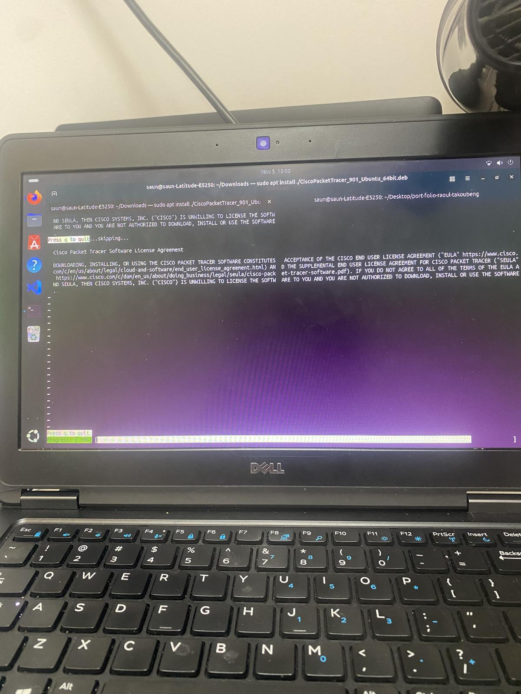

*La licence s'affiche dans un pager. On quitte cette vue avec q. / The licence appears in a pager. Press q to leave this view.*

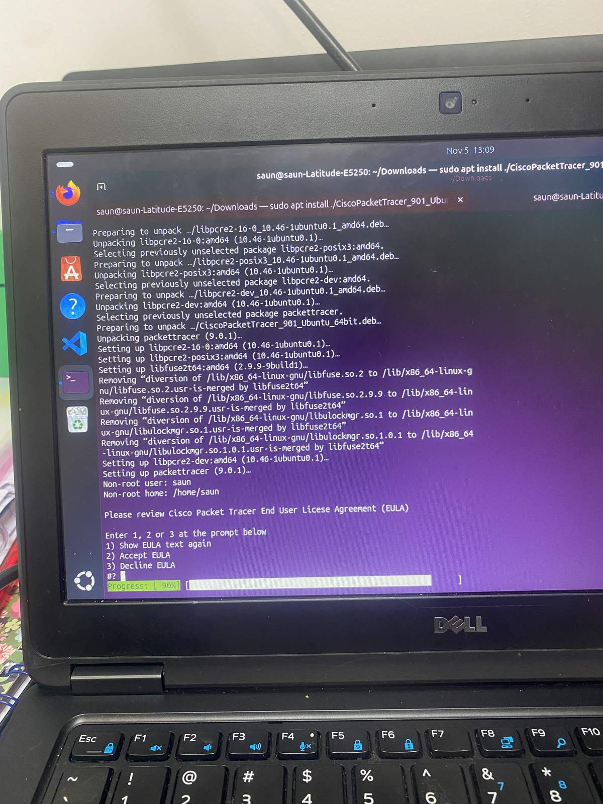

*Le menu de la licence, installation déjà à 90 %. / The licence prompt, with the install already at 90%.*

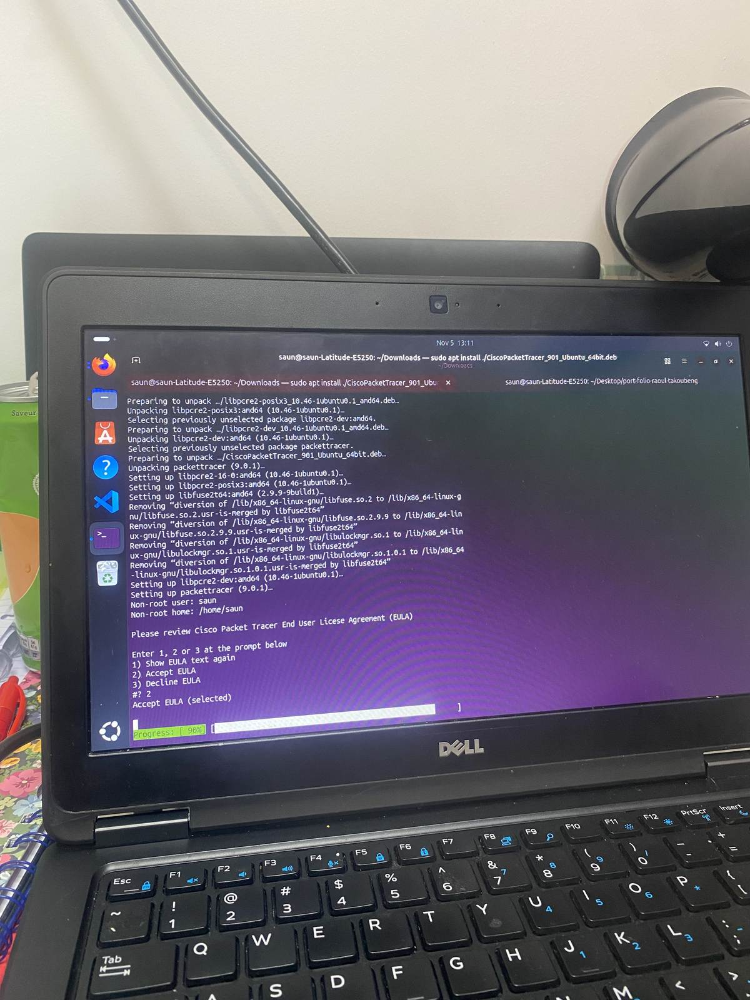

*J'ai saisi 2 : Accept EULA (selected). / I entered 2: Accept EULA (selected).*

### Symptôme / Symptom

Après l'installation, le lancement échouait tout de suite. Le terminal a d'abord affiché des avertissements `xdg-icon-resource`, puis une notice `_apt` :

After the install, the application failed immediately on launch. The terminal first showed `xdg-icon-resource` warnings, then an `_apt` notice:

```text
Notice: Download is performed unsandboxed as root as file
'/home/saun/Downloads/CiscoPacketTracer_901_Ubuntu_64bit.deb'
couldn't be accessed by user '_apt' - pkgAcquire::Run (13: Permission denied)
Warning: Operation was interrupted before it could finish
```

`apt` lit les paquets avec un utilisateur dédié, `_apt`. Un fichier `.deb` placé dans mon dossier personnel n'est souvent pas lisible par `_apt`, d'où le recours à une lecture en root, hors isolement. Ce n'est pas forcément une installation ratée. Pour éviter l'avertissement, on peut copier le paquet dans `/tmp` avant de l'installer. Le vrai blocage est venu ensuite :

`apt` reads packages as a dedicated user, `_apt`. A `.deb` sitting in my home directory is often unreadable for `_apt`, so `apt` falls back to an unsandboxed root read. That does not always mean the install failed. Copying the package to `/tmp` first avoids the warning. The real blockage came next:

```text
./PacketTracer: error while loading shared libraries: libOpenGL.so.0:
cannot open shared object file: No such file or directory
```

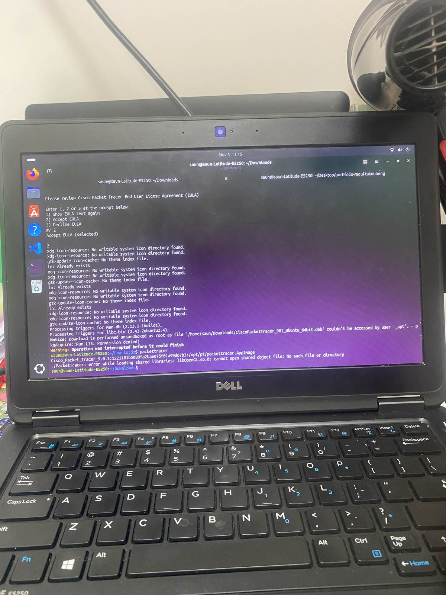

*L'avertissement _apt, puis l'erreur libOpenGL.so.0. / The _apt warning, then the libOpenGL.so.0 error.*

J'ai ensuite voulu installer les paquets manquants, mais j'ai écrit `libg11` au lieu de `libgl1`. `apt` a répondu `Unable to locate package libg11`.

I then tried to install the missing packages, but I wrote `libg11` instead of `libgl1`. `apt` answered `Unable to locate package libg11`.

```text
sudo apt install libopengl0 libg11 libglx-mesa0 libxcb-xinerama0
Error: Unable to locate package libg11
```

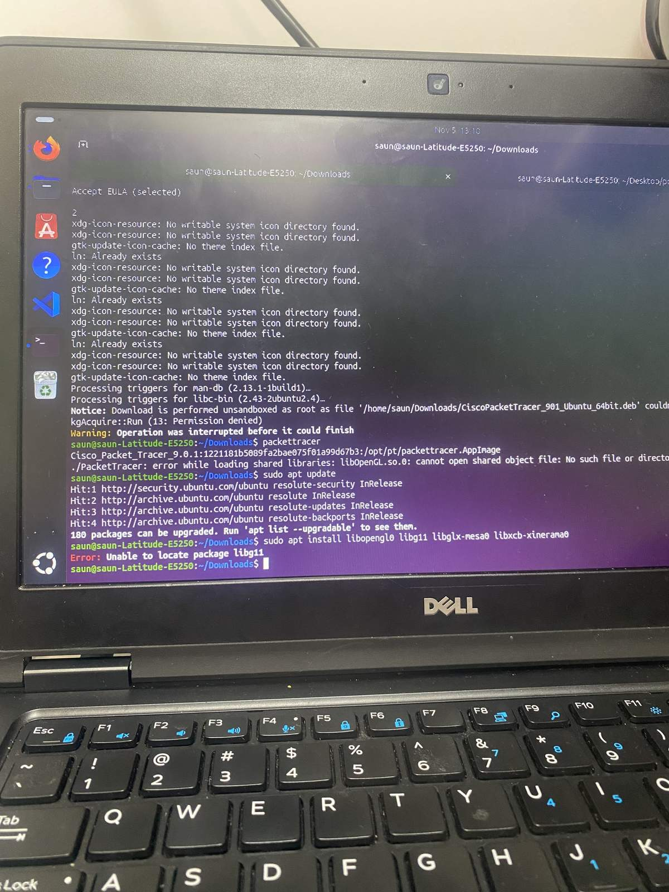

*Faute de frappe : un l lu comme un 1. On vérifie le nom avec `apt search libgl1`. / A typo: the letter l read as a 1. Check the name with `apt search libgl1`.*

Une fois les noms corrigés, j'ai installé les paquets Mesa et `libopengl0`. L'erreur OpenGL a disparu. Un second message est apparu :

Once the names were corrected, I installed the Mesa packages and `libopengl0`. The OpenGL error was gone. A second message appeared:

```text
This application failed to start because no Qt platform plugin could be initialized.
Reinstalling the application may fix this problem.
Available platform plugins are: linuxfb, xcb.
Aborted (core dumped)
```

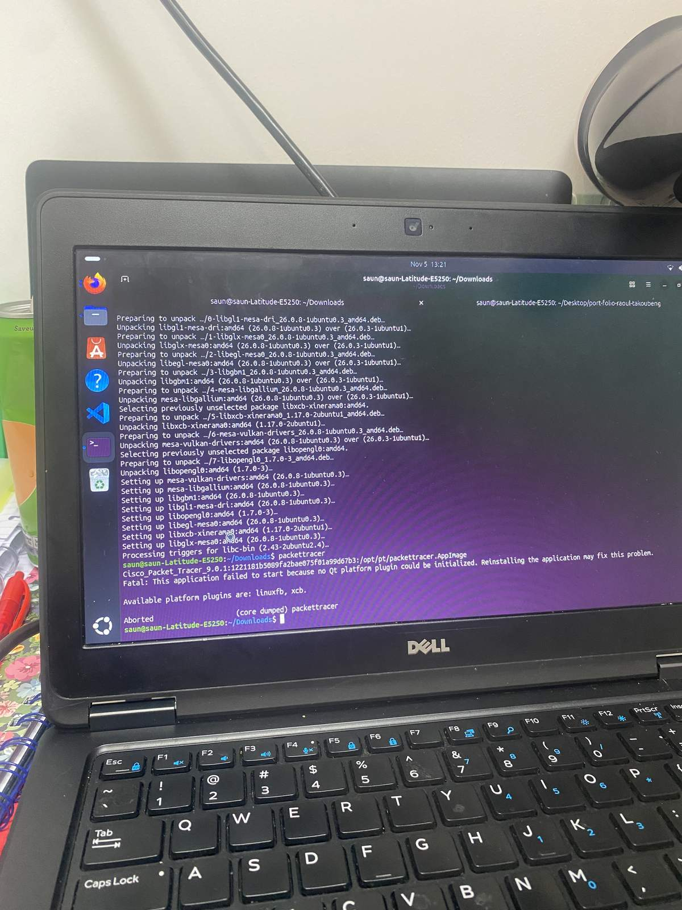

*Les paquets Mesa sont là, mais Qt ne peut pas initialiser le greffon xcb. / Mesa is in place, but Qt cannot initialise the xcb plugin.*

Packet Tracer ne s'ouvrait toujours pas. L'interface graphique ne s'affichait pas du tout.

Packet Tracer still would not open. The graphical interface did not appear at all.

### Diagnostic / Diagnosis

Le premier message est assez direct : au démarrage, le binaire cherche la bibliothèque partagée `libOpenGL.so.0` et ne la trouve pas. Ce n'est pas une erreur interne à Packet Tracer. C'est une dépendance manquante. Sur Ubuntu, ce fichier est fourni par le paquet `libopengl0`, souvent accompagné des paquets Mesa.

The first message is fairly direct: at startup, the binary looks for the shared library `libOpenGL.so.0` and does not find it. This is not an internal Packet Tracer fault. It is a missing dependency. On Ubuntu, that file is provided by the `libopengl0` package, often together with the Mesa packages.

Le second message vient de Qt, la bibliothèque graphique utilisée par Packet Tracer. « xcb » est le greffon qui relie Qt au serveur d'affichage X11. S'il ne peut pas s'initialiser, il manque en général d'autres bibliothèques XCB, typiquement `libxcb-cursor0` et `libxkbcommon-x11-0`, en plus de `libxcb-xinerama0`. Ce n'était pas le moment de réinstaller Packet Tracer.

The second message comes from Qt, the graphical toolkit Packet Tracer uses. "xcb" is the plugin that connects Qt to the X11 display server. If it cannot initialise, further XCB libraries are usually missing, typically `libxcb-cursor0` and `libxkbcommon-x11-0`, in addition to `libxcb-xinerama0`. That was not a reason to reinstall Packet Tracer.

### Correction / Fix

```bash
sudo apt update
sudo apt install libopengl0 libgl1 libglx-mesa0 libxcb-xinerama0
sudo apt install libxcb-cursor0 libxkbcommon-x11-0
```

Après l'installation de `libopengl0` et des paquets Mesa, l'erreur `libOpenGL.so.0` a disparu. En installant les dépendances xcb manquantes, Packet Tracer 9.0.1 s'est lancé. Le 5 novembre à 13 h 26, j'ai eu l'écran de connexion Cisco Networking Academy.

After installing `libopengl0` and the Mesa packages, the `libOpenGL.so.0` error was gone. Installing the missing xcb dependencies is what unblocked Packet Tracer 9.0.1. On 5 November at 13:26, the Cisco Networking Academy login screen appeared.

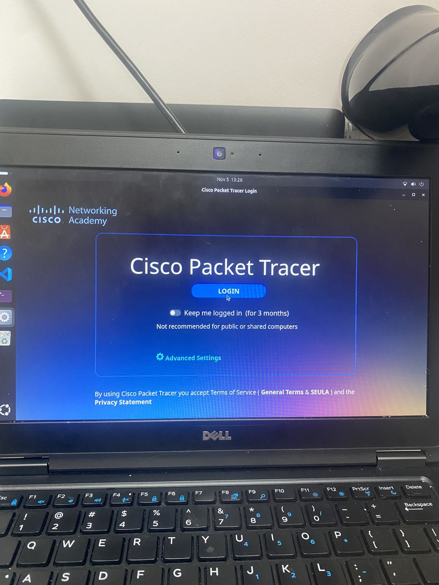

*Packet Tracer s'ouvre enfin. / Packet Tracer finally opens.*

### Leçon / Lesson

Quand un programme graphique refuse de démarrer, je lis d'abord le message exact. « cannot open shared object file » veut dire qu'une bibliothèque système manque. Un nom de paquet se vérifie avec `apt search`, surtout quand un l et un 1 se ressemblent. Un avertissement `_apt` sur un `.deb` dans le dossier personnel parle souvent d'un droit d'accès, pas d'un paquet corrompu. Packet Tracer suppose des dépendances que Ubuntu n'installe pas toujours par défaut, surtout sur une machine un peu ancienne.

When a graphical program refuses to start, I read the exact message first. "cannot open shared object file" means a system library is missing. A package name should be checked with `apt search`, especially when the letter l and the digit 1 look alike. An `_apt` warning about a `.deb` in the home directory is often a permission issue, not a corrupted package. Packet Tracer assumes dependencies that Ubuntu does not always install by default, especially on an older machine.

---

## Incident 2 : perte d'accès au compte Linux / Loss of access to the Linux account

### Symptôme / Symptom

Je n'arrivais plus à ouvrir une session avec mon compte utilisateur sur Ubuntu : le mot de passe n'était plus accepté. La machine démarrait normalement jusqu'à l'écran de connexion, mais je restais bloquée à cette étape.

I could no longer sign in to my Ubuntu user account: the password was no longer accepted. The machine booted normally as far as the login screen, but I was stuck there.

### Diagnostic / Diagnosis

Le système, lui, démarrait. Ce n'était donc pas un disque inaccessible ni un noyau qui refusait de charger. Le problème se situait au niveau du compte. Sur Linux, on peut réinitialiser le mot de passe d'un utilisateur depuis un interpréteur root, à condition d'entrer en mode de récupération.

The system itself was booting. So this was not an unreachable disk, nor a kernel that failed to load. The problem was at the account level. On Linux, a user's password can be reset from a root shell, provided one can enter recovery mode.

### Correction / Fix

J'ai ouvert le menu de démarrage ponctuel du Dell Latitude E5250. Le mode était `LEGACY`, avec `Secure Boot: OFF`. L'entrée `Internal HDD` était sélectionnée. Le menu montrait aussi des entrées UEFI, dont Ubuntu. La révision du BIOS est A05. Legacy et UEFI sont deux façons, pour le micrologiciel, de lancer le système ; sur ce poste, les deux apparaissent dans le même menu.

I opened the one-time boot menu on the Dell Latitude E5250. Boot mode was `LEGACY`, with `Secure Boot: OFF`. `Internal HDD` was selected. The menu also showed UEFI entries, including Ubuntu. The BIOS revision is A05. Legacy and UEFI are two firmware styles for starting a system; on this machine, both appear in the same menu.

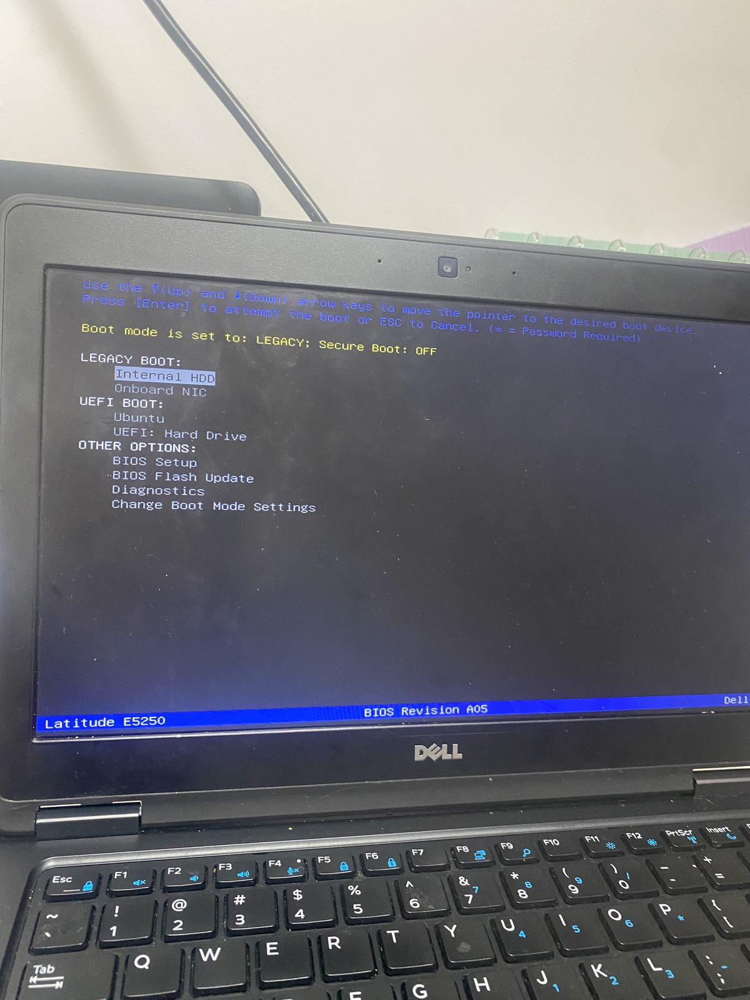

*Menu de démarrage ponctuel : mode Legacy, Secure Boot désactivé, disque interne sélectionné. / One-time boot menu: Legacy mode, Secure Boot off, internal drive selected.*

Le menu GRUB proposait Ubuntu, les options avancées, des tests de mémoire et une entrée vers le micrologiciel UEFI. Pour réinitialiser le mot de passe, j'ai utilisé Advanced options for Ubuntu, puis le mode de récupération.

The GRUB menu offered Ubuntu, advanced options, memory tests and an entry to the UEFI firmware. To reset the password, I used Advanced options for Ubuntu, then recovery mode.

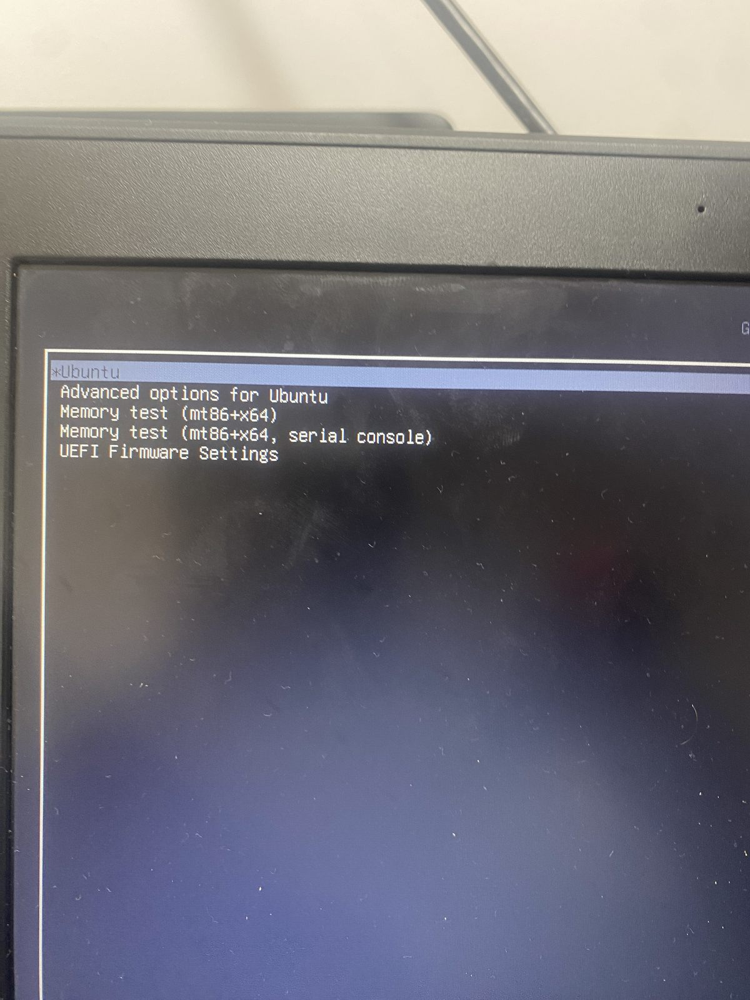

*Le menu GRUB. L'entrée utile était Advanced options for Ubuntu. / The GRUB menu. The useful entry was Advanced options for Ubuntu.*

À un moment, je suis aussi tombée sur l'invite minimale `grub>` de GNU GRUB 2.14. Ce n'est pas une session Ubuntu. C'est le petit interpréteur de GRUB, utile pour lancer un système à la main si le menu ne s'affiche pas. Ce n'est pas là que l'on change un mot de passe utilisateur.

At one point I also landed on the minimal `grub>` prompt from GNU GRUB 2.14. This is not an Ubuntu session. It is GRUB's own small shell, useful to boot a system by hand if the menu does not appear. It is not where a user password is reset.

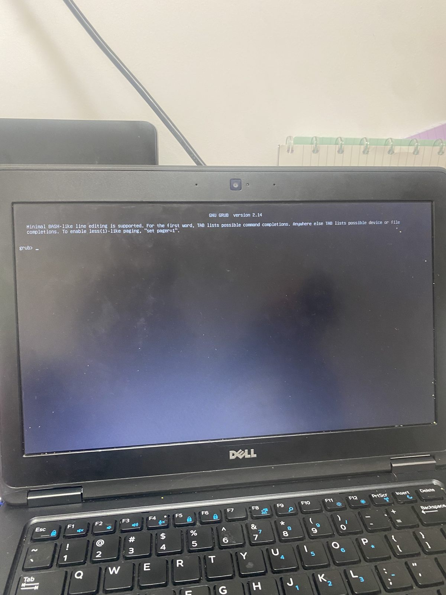

*L'invite grub> : on est encore dans GRUB, pas dans Ubuntu. / The grub> prompt: this is still GRUB, not Ubuntu.*

Dans le menu de récupération, le système de fichiers est en lecture seule (`Recovery Menu (filesystem state: read-only)`). J'ai choisi `root`, « Drop to root shell prompt ».

In the recovery menu, the filesystem is read-only (`Recovery Menu (filesystem state: read-only)`). I selected `root`, "Drop to root shell prompt".

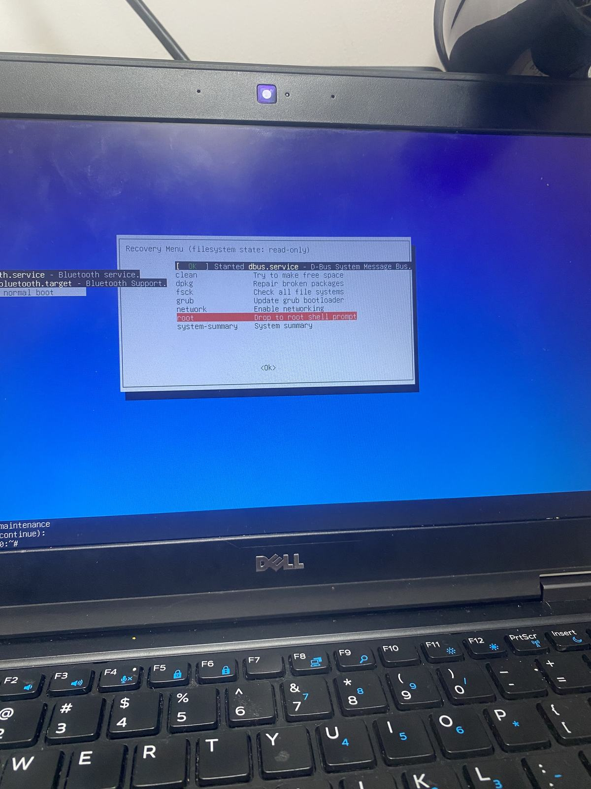

*Menu de récupération, partition racine en lecture seule, entrée root sélectionnée. / Recovery menu, root filesystem read-only, root entry selected.*

Avant de changer quoi que ce soit, j'ai remonté la racine en lecture-écriture, puis j'ai réinitialisé le mot de passe de mon compte `saun` :

Before changing anything, I remounted the root filesystem read-write, then reset the password for my account `saun`:

```bash
mount -o remount,rw /
passwd saun
```

`passwd` a d'abord refusé un mot de passe trop court : `BAD PASSWORD: The password is shorter than 8 characters`. Les règles PAM exigent au moins huit caractères. J'ai aussi eu `Sorry, passwords do not match` quand les deux saisies n'étaient pas identiques. Ensuite : `password updated successfully`. J'ai ensuite tapé `REBOOT` en majuscules : `REBOOT: command not found`. Sous Linux, les commandes sont sensibles à la casse. La bonne commande est `reboot`.

`passwd` first rejected a password that was too short: `BAD PASSWORD: The password is shorter than 8 characters`. PAM rules require at least eight characters. I also got `Sorry, passwords do not match` when the two entries were not identical. Then: `password updated successfully`. I then typed `REBOOT` in capitals: `REBOOT: command not found`. Linux commands are case-sensitive. The right command is `reboot`.

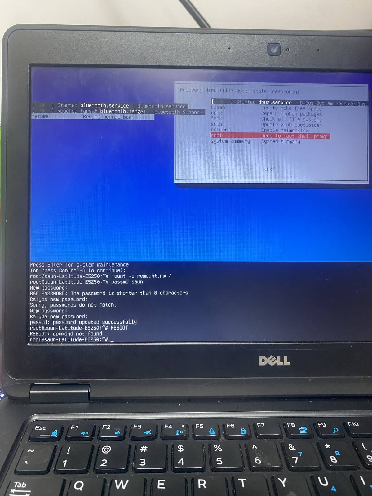

*Remount, règles de mot de passe à huit caractères, puis l'erreur REBOOT. / Remount, eight-character password rules, then the REBOOT error.*

Après le redémarrage, j'ai pu ouvrir une session normalement. Je n'ai pas réinstallé Ubuntu.

After the reboot, I was able to sign in normally. I did not reinstall Ubuntu.

### Leçon / Lesson

Perdre l'accès à son propre compte n'oblige pas à réinstaller le système. Le mode de récupération GRUB donne un interpréteur root précisément pour ce genre de situation. Il faut remonter la partition racine en lecture-écriture avant `passwd`, respecter la longueur minimale du mot de passe, et écrire `reboot` en minuscules.

Losing access to my own account does not mean I have to reinstall the system. GRUB recovery mode provides a root shell for exactly this kind of situation. The root partition must be remounted read-write before `passwd`, the minimum password length must be respected, and `reboot` must be typed in lowercase.

Cette procédure a aussi un versant sécurité. Si GRUB n'est pas protégé, le mode de récupération donne un interpréteur root sans le mot de passe de l'utilisateur. Sur mon poste personnel, c'est ainsi que j'ai repris la main. Dans une entreprise, c'est un risque : on protège GRUB avec un mot de passe, et on chiffre le disque, par exemple avec LUKS, pour que le mode de récupération ne suffise pas à lire ou à modifier les données. L'accès physique à un poste de travail est déjà un accès à contrôler.

This procedure also has a security side. If GRUB is unprotected, recovery mode gives a root shell without the user password. On my personal laptop, that is how I got back in. In a company, this is a risk: GRUB should be password-protected, and the disk should be encrypted, for example with LUKS, so that recovery mode alone is not enough to read or change the data. Physical access to a workstation is already an access path to control.
